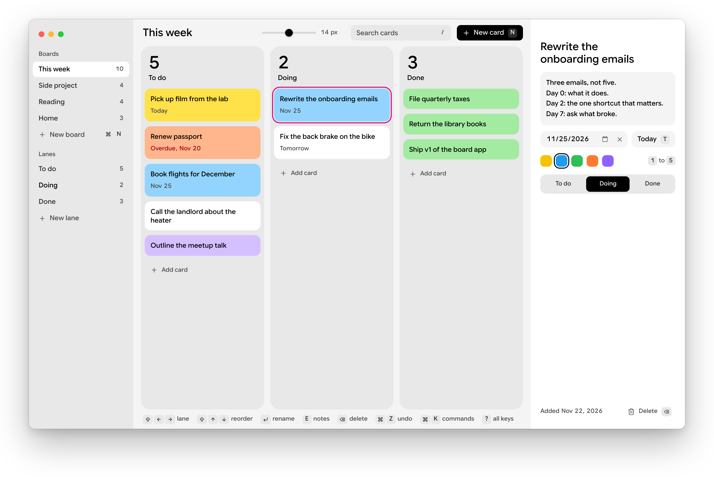
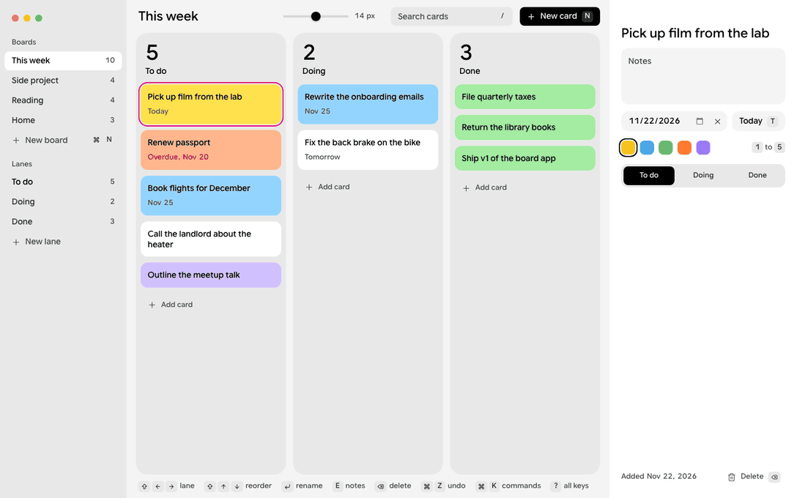
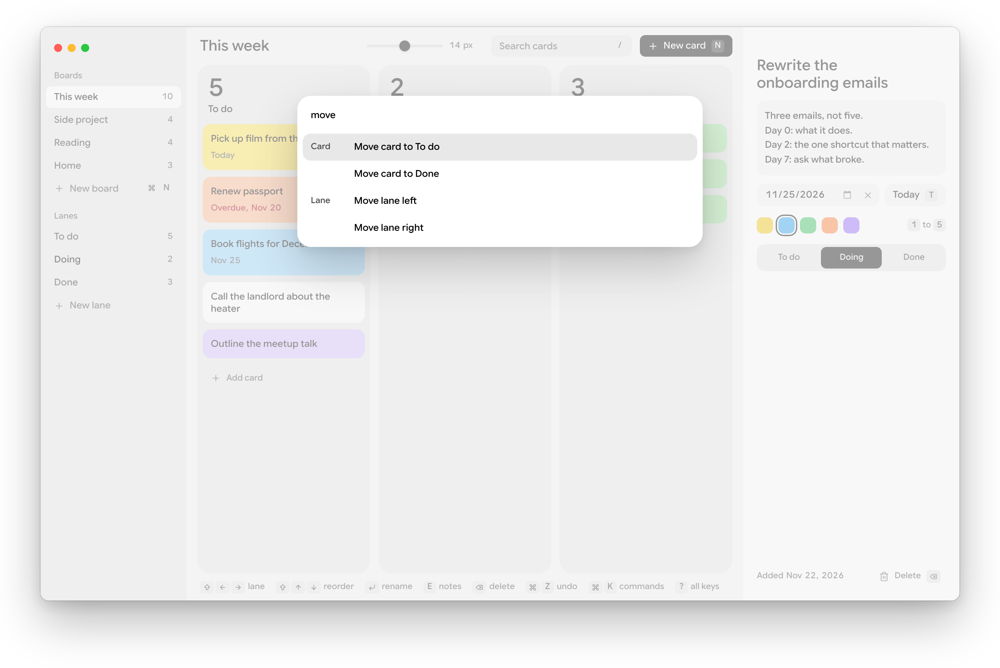

# Kanban

A kanban board for the Mac that you drive from the keyboard. No account, no server, no spinner. Every change is on disk before you press the next key.



## Hands on the keys

Every move below is a keypress. The mouse never touches the board.



Most boards are built for the mouse and a login. This one is built for the person who has a task in their head and wants it on the board before the thought is gone: `N`, type, `Enter`, done. The next empty card is already open, so you can dump a whole list without stopping.

- **Fast.** Every action has a key and lands well under 100 ms. The slowest key event measured 24 ms with 300 cards on the board.
- **Nothing is lost.** One SQLite file, one transaction per change, flushed on quit.
- **No confirm dialogs.** Undo goes back 300 steps, deletes included. `⌘Z` is the safety net.
- **Mouse still works.** Drag cards between lanes with a mouse or trackpad.

## What's in it

- **Boards.** As many as you want. `⌘1` to `⌘9` jumps between them.
- **Lanes.** Rename, reorder and add lanes per board. To do, Doing, Done to start.
- **Cards.** A title, notes, a due date and one of five highlighter colors. Nothing else.
- **Commands.** `⌘K` opens every action, plus a search over the cards on every board.
- **Search.** `/` filters the current board as you type.
- **Density.** One slider (or `⌘-` and `⌘=`) takes card text from 12.5 px to 15.5 px. Spacing scales with it.
- **Layout.** Three panes on a wide window. Under 1320 px the inspector becomes a sheet, under 900 px the sidebar becomes a drawer.



## Keys

Press `?` in the app for this list.

| Keys | Action |
|---|---|
| `↑` `↓` `←` `→` or `H` `J` `K` `L` | Move the selection |
| `⇧←` `⇧→` | Move the card to the next lane |
| `⇧↑` `⇧↓` | Reorder the card |
| `N` / `⇧N` | New card at the bottom / top of the lane |
| `↵` | Rename the card |
| `E` | Edit notes |
| `1` to `5`, `0` | Color the card, clear the color |
| `T` / `⇧T` | Due today / clear the date |
| `D` | Pick a due date |
| `⌫` | Delete the card |
| `⌘Z` / `⇧⌘Z` | Undo / redo |
| `/` | Search this board |
| `⌘K` | Commands |
| `⌘1` to `⌘9` | Switch board |
| `⌘N` | New board |
| `⌘-` `⌘=` `⌘0` | Denser, roomier, reset |
| `⌘\` | Show or hide the sidebar |
| `⌘I` | Show or hide the inspector |
| `Esc` | Close the sheet, clear the search |

## Run it

You need macOS, Node 22 or later, and Rust (stable), plus the Xcode command line tools (`xcode-select --install`).

```sh
git clone https://github.com/karimbabasf/kanban
cd kanban
npm install
npm run tauri build -- --bundles app
open src-tauri/target/release/bundle/macos/Kanban.app
```

Drag `Kanban.app` into `/Applications` to keep it. The app is not signed, but a build from source opens without a Gatekeeper warning.

For development:

```sh
npm run tauri dev    # the Mac app with hot reload
npm run dev          # browser build on localhost:1420, data in localStorage
```

Your data lives in one file: `~/Library/Application Support/com.karimbaba.kanban/kanban.db`. Quit the app and copy it to back up.

## Test

```sh
npm test                    # model: moves, undo diffs, deletes, seed
cd src-tauri && cargo test  # SQLite: upserts, deletes, migrations
npx tsc --noEmit
```

## How it works

```
src/model      pure functions on immutable records: boards, lanes, cards
  store.ts     state, undo history (300 snapshots), typing coalesced into one step
  diff.ts      compares two snapshots by object identity, emits only changed rows
  persist.ts   sends each diff to Rust; writes coalesce while one is in flight
src/ui         React 19 + Motion: sidebar, board, inspector, palette
src-tauri      Tauri 2 + rusqlite: one transaction per diff, WAL, synchronous FULL
```

Because records are immutable, undo is a pointer swap and a save is a diff of two snapshots. A card move writes a few rows, not the board. The browser build swaps SQLite for localStorage behind the same two calls, which is how the screenshots above were made.

The look is called Highlighter: white paper, black ink, cards in the colors of highlighter pens, and a magenta ring on the selection. One typeface ([Google Sans Flex](https://fonts.google.com/specimen/Google+Sans+Flex)) at one weight. Motion uses one curve and three durations (120, 220 and 320 ms) and turns off when macOS asks for reduced motion.
